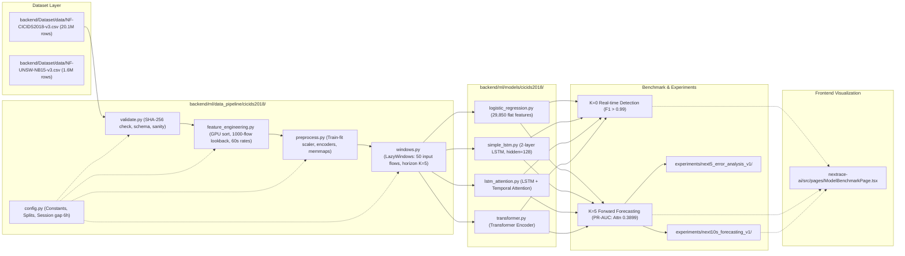

# NEXTRACE AI — Master Project Dependency & Architecture Graph
> **AI AGENT QUICK-START MANUAL**: Use this document for **$O(1)$ instant navigation**. Rather than grepping or reading multiple files across the repository, locate your objective in the **Quick Intent Router (Section 1)** or the **Subsystem Graphs (Sections 2–5)** to immediately identify the exact files, functions, lines, and data flows. All paths are relative to the repository root.

---

## 1. $O(1)$ AI Agent Query Router (Instant Lookup Matrix)

When given a user prompt, match the prompt objective to the table below to jump directly to the responsible file and symbol without exploratory codebase search.

| User Request / Objective | Primary File & Symbol | Supporting Dependencies / Data Flow | Key Thresholds / Logic |
| :--- | :--- | :--- | :--- |
| **Change synthetic packet generation (IPs, ports, protocols, fake payloads)** | [`nextrace-ai/backend/traffic/generator.py#L79-L228`](nextrace-ai/backend/traffic/generator.py#L79-L228)<br>`generate_benign_event()`<br>`generate_suspicious_event()` | Called by [`nextrace-ai/backend/services/live_session.py#L137`](nextrace-ai/backend/services/live_session.py#L137) | `_INTERNAL_HOSTS`, `_SUSPICIOUS_SRC`, `_SUSPICIOUS_PORTS`, `_FILES_SUSPICIOUS`, C2 domains |
| **Modify live streaming session lifecycle (start/stop/rates/window aggregation)** | [`nextrace-ai/backend/services/live_session.py#L34-L280`](nextrace-ai/backend/services/live_session.py#L34-L280)<br>`LiveSession.start()`, `.stop()`, `._run_generator()`, `._run_window_timer()` | Uses [`nextrace-ai/backend/features/engineering.py#L13`](nextrace-ai/backend/features/engineering.py#L13)<br>Broadcasts via [`nextrace-ai/backend/api/websocket_handler.py#L9`](nextrace-ai/backend/api/websocket_handler.py#L9) | Default window: 15 s (clamped 5–60 s). `PARTIAL_TICK_SECONDS = 1.0 s`. In-memory singleton. |
| **Tune live rule-based attack forecaster & stages** | [`nextrace-ai/backend/forecasting/engine.py#L52-L297`](nextrace-ai/backend/forecasting/engine.py#L52-L297)<br>`RuleBasedForecastEngine._classify()`, `._compute_confidence()`, `._explain()` | Called by [`nextrace-ai/backend/services/live_session.py#L60`](nextrace-ai/backend/services/live_session.py#L60) | 4 Stages: Recon $\to$ Initial Access $\to$ Lateral Movement $\to$ Exfiltration. Stage thresholds: `_SUSP_RATIO_EX=0.40`, `_BYTE_HIGH=40,000`. |
| **Inspect or adjust sliding window feature engineering** | [`nextrace-ai/backend/features/engineering.py#L13-L80`](nextrace-ai/backend/features/engineering.py#L13-L80)<br>`compute_temporal_state()` | Consumed by `live_session.py` and `RuleBasedForecastEngine` | Aggregates packet count, bytes, flows, unique IPs/ports, protocol counter, connection rate. |
| **Upload, parse, and process raw PCAP files** | [`nextrace-ai/backend/historical/parser.py#L305-L365`](nextrace-ai/backend/historical/parser.py#L305-L365)<br>`parse_pcap()`, `_parse_dpkt()` | Called by [`nextrace-ai/backend/api/historical.py#L160`](nextrace-ai/backend/api/historical.py#L160) $\to$ [`nextrace-ai/backend/historical/analyzer.py#L43`](nextrace-ai/backend/historical/analyzer.py#L43) | Reads `.pcap`, `.pcapng`, `.cap`, `.gz` using dpkt (primary) with Scapy fallback. |
| **Adjust historical heuristic detection (port scans, brute-force, DoS, DPI)** | [`nextrace-ai/backend/historical/analyzer.py#L18-L375`](nextrace-ai/backend/historical/analyzer.py#L18-L375)<br>`HeuristicConfig`, `_detect_suspicious_activity()` | Called in `run_analysis()` pipeline; feeds `_build_activity_timeline()` | `AUTH_PORTS`, `MALICIOUS_BACKDOOR_PORTS`, `MALICIOUS_SIGNATURES` (SQLi, XSS, shellcode, reverse shells). |
| **Investigate forensic hypotheses generation ($H1$–$H5$)** | [`nextrace-ai/backend/forensic/hypotheses.py#L78-L442`](nextrace-ai/backend/forensic/hypotheses.py#L78-L442)<br>`generate_hypotheses()`, `_h1`–`_h5` | Called by [`nextrace-ai/backend/forensic/analyzer.py#L50`](nextrace-ai/backend/forensic/analyzer.py#L50) $\to$ [`nextrace-ai/backend/api/forensic.py#L65`](nextrace-ai/backend/api/forensic.py#L65) | Synthesizes supporting/contradicting evidence, limitations, and base confidence scores. |
| **Tune anti-forensic indicators & evidence limitations** | [`nextrace-ai/backend/forensic/anti_forensic.py#L52-L254`](nextrace-ai/backend/forensic/anti_forensic.py#L52-L254)<br>`detect_anti_forensic_indicators()` | Called by `forensic/analyzer.py` | Detects traffic gaps ($\ge 30\text{ s}$), capture boundary truncations ($< 5\text{ s}$), incomplete TCP sessions. |
| **Modify Attack Trajectory Simulator (Fixed-K steps, profiles)** | [`nextrace-ai/backend/simulator/scenarios.py#L24-L169`](nextrace-ai/backend/simulator/scenarios.py#L24-L169)<br>`_ALL_STAGE_PROFILES`<br>[`nextrace-ai/backend/simulator/engine.py#L35`](nextrace-ai/backend/simulator/engine.py#L35)<br>`SimulationEngine` | Invoked by [`nextrace-ai/backend/api/simulator.py#L42`](nextrace-ai/backend/api/simulator.py#L42) | 8 stage profiles ($A$–$H$: Recon to Impact). Autoregressive multi-horizon forecasting simulation. |
| **Modify Alert storage, triage, deduplication, or status** | [`nextrace-ai/backend/alerts/store.py#L32-L159`](nextrace-ai/backend/alerts/store.py#L32-L159)<br>`create_alert()`, `list_alerts()`, `get_stats()` | Schema in [`nextrace-ai/backend/alerts/models.py#L24`](nextrace-ai/backend/alerts/models.py#L24)<br>API in [`nextrace-ai/backend/api/alerts.py#L30`](nextrace-ai/backend/api/alerts.py#L30) | In-memory store capped at 5000 alerts. Idempotent deduplication via `_BY_DEDUPE_KEY`. |
| **Offline ML data preprocessing (NF-CICIDS2018-v3)** | [`backend/ml/data_pipeline/cicids2018/`](backend/ml/data_pipeline/cicids2018/)<br>`preprocess.py`, `feature_engineering.py`, `windows.py` | Consumes `backend/Dataset/data/NF-CICIDS2018-v3.csv` | 20.1M rows. Zero-leakage chronological session splits (Train: 8 days, Val: 1 day, Test: 1 day). 75 numeric + 6 cat embeddings. |
| **Offline ML model definitions & training (CICIDS2018)** | [`backend/ml/models/cicids2018/`](backend/ml/models/cicids2018/)<br>`lstm_attention.py`, `simple_lstm.py`, `transformer.py`, `logistic_regression.py` | Training scripts: `train_*_next5.py` and `train_*_detection.py` | Frozen evaluation protocol: $K=0$ (real-time detection) vs $K=5$ (next 5 flows forecast). |
| **Inspect ML benchmark numbers displayed on Frontend** | [`nextrace-ai/src/pages/ModelBenchmarkPage.tsx#L42-L73`](nextrace-ai/src/pages/ModelBenchmarkPage.tsx#L42-L73)<br>`MODELS`, `RESULTS`, `TASKS` | Experiment reports in [`experiments/`](experiments/) and [`REPORTS_INDEX.md`](REPORTS_INDEX.md) | Fixed empirical benchmark table (PR-AUC, ROC-AUC, F1, Precision, Recall). |
| **Frontend live monitoring UI, charts, or state** | [`nextrace-ai/src/pages/LiveMonitoringPage.tsx`](nextrace-ai/src/pages/LiveMonitoringPage.tsx)<br>[`nextrace-ai/src/store/liveStore.ts`](nextrace-ai/src/store/liveStore.ts) | Connects to `ws://localhost:8000/ws/live` via [`nextrace-ai/src/services/websocket.ts`](nextrace-ai/src/services/websocket.ts) | Reactive Zustand store managing rolling packet buffer, timeline, and current forecast. |
| **Frontend REST API client / backend communications** | [`nextrace-ai/src/services/api.ts#L32-L230`](nextrace-ai/src/services/api.ts#L32-L230)<br>`apiService` | Consumed by all pages & stores | Configurable via `VITE_API_BASE_URL` (default `http://localhost:8000`). |

---

## 2. End-to-End System Architecture Graph

```mermaid
flowchart TB
    subgraph Frontend ["Frontend — React 19 / TypeScript (Vite :5173)"]
        UI_Live["LiveMonitoringPage.tsx"]
        UI_Hist["HistoricalAnalysisPage.tsx"]
        UI_Forensic["InvestigationPage.tsx"]
        UI_Sim["AttackPredictionPage / SimulationPage.tsx"]
        UI_Bench["ModelBenchmarkPage.tsx"]
        UI_Alerts["AlertsPage.tsx"]
        
        Store_Live["liveStore.ts"]
        Store_Hist["historicalStore.ts"]
        Store_Forensic["forensicStore.ts"]
        Store_Sim["simulatorStore.ts"]
        Store_Alert["alertStore.ts"]
        
        API_Client["services/api.ts (Fetch REST Client)"]
        WS_Client["services/websocket.ts (Auto-reconnecting WS)"]
        
        UI_Live --> Store_Live
        UI_Hist --> Store_Hist
        UI_Forensic --> Store_Forensic
        UI_Sim --> Store_Sim
        UI_Alerts --> Store_Alert
        
        Store_Live --> WS_Client & API_Client
        Store_Hist --> API_Client
        Store_Forensic --> API_Client
        Store_Sim --> API_Client
        Store_Alert --> API_Client
    end

    subgraph BackendGateway ["FastAPI Application (main.py :8000)"]
        FastAPI_App["FastAPI App (main.py)"]
        WS_Endpoint["/ws/live (websocket_handler.py)"]
        
        R_Live["/api/live/*"]
        R_Forecast["/api/forecast/*"]
        R_Hist["/api/historical/*"]
        R_Forensic["/api/forensic/*"]
        R_Sim["/api/simulator/*"]
        R_Alerts["/api/alerts/*"]
        R_Reports["/api/reports/*"]
        R_Admin["/api/admin/*"]
        
        FastAPI_App --> WS_Endpoint
        FastAPI_App --> R_Live & R_Forecast & R_Hist & R_Forensic & R_Sim & R_Alerts & R_Reports & R_Admin
    end

    WS_Client -.->|WebSocket /ws/live| WS_Endpoint
    API_Client -->|HTTP /api/*| BackendGateway

    subgraph CoreServices ["Backend Core Services & Engines"]
        LiveService["live_session.py (Singleton LiveSession)"]
        PacketGen["traffic/generator.py (Demo Packet Engine)"]
        FeatureEng["features/engineering.py (Temporal Aggregator)"]
        RuleForecaster["forecasting/engine.py (RuleBasedForecastEngine)"]
        
        PCAPParser["historical/parser.py (dpkt / Scapy)"]
        FlowBuilder["historical/flow_builder.py (5-Tuple Aggregator)"]
        HistAnalyzer["historical/analyzer.py (Heuristic & DPI Detection)"]
        
        ForensicHypo["forensic/hypotheses.py (H1-H5 Generators)"]
        AntiForensic["forensic/anti_forensic.py (Integrity & Gaps)"]
        AuditLedger["forensic/integrity.py (SHA-256 Ledger)"]
        
        SimEngine["simulator/engine.py (SimulationEngine)"]
        SimScenarios["simulator/scenarios.py (Stage Profiles A-H)"]
        
        AlertStore["alerts/store.py (In-Memory Bounded Store)"]
        ReportBuilder["reports/report_builder.py (Finding Synthesizer)"]
    end

    R_Live --> LiveService
    R_Forecast --> LiveService
    WS_Endpoint --> LiveService
    LiveService --> PacketGen
    LiveService --> FeatureEng
    LiveService --> RuleForecaster

    R_Hist --> PCAPParser --> FlowBuilder --> HistAnalyzer
    R_Forensic --> ForensicHypo & AntiForensic & AuditLedger
    ForensicHypo -.->|Reads Suspicious Events| HistAnalyzer
    
    R_Sim --> SimEngine --> SimScenarios
    R_Alerts --> AlertStore
    R_Reports --> ReportBuilder
```



---

## 3. Offline Machine Learning & Data Pipeline Graph

This subsystem handles dataset ingestion, leakage-safe preprocessing, window formulation, and benchmark model training.



---

## 4. Subsystem Directory Breakdown & Dependencies

### A. Backend Modules (`nextrace-ai/backend/`)

#### 1. Entry Point & API Routers (`backend/api/`)
* **[`nextrace-ai/backend/main.py`](nextrace-ai/backend/main.py)**: Entry point. Mounts CORS, security headers, starts Uvicorn on `127.0.0.1:8000`.
* **[`nextrace-ai/backend/api/live.py`](nextrace-ai/backend/api/live.py)**: Start (`/api/live/start`), Stop (`/api/live/stop`), Status (`/api/live/status`), Summary. Interacts directly with `live_session`.
* **[`nextrace-ai/backend/api/websocket_handler.py`](nextrace-ai/backend/api/websocket_handler.py)**: Fast async queue broadcaster (`/ws/live`). Pushes `packet_event`, `temporal_state_update`, and `forecast_update`.
* **[`nextrace-ai/backend/api/forecast.py`](nextrace-ai/backend/api/forecast.py)**: `/api/forecast/current`. Pulls most recent forecast from `live_session`.
* **[`nextrace-ai/backend/api/historical.py`](nextrace-ai/backend/api/historical.py)**: `/api/historical/upload` & `/api/historical/demo`. Enqueues background parsing jobs stored in memory in `_JOBS`.
* **[`nextrace-ai/backend/api/forensic.py`](nextrace-ai/backend/api/forensic.py)**: `/api/forensic/{job_id}/analyze` & `/api/forensic/{job_id}/result`. Executes forensic reasoning on completed PCAP jobs.
* **[`nextrace-ai/backend/api/simulator.py`](nextrace-ai/backend/api/simulator.py)**: `/api/simulator/start`, `/status`, `/pause`, `/resume`, `/next`, `/reset`. Manages in-memory simulation runs in `_SIMULATIONS`.
* **[`nextrace-ai/backend/api/alerts.py`](nextrace-ai/backend/api/alerts.py)**: `/api/alerts`, `/stats`, `/{id}/acknowledge`, `/{id}/resolve`. Connects to `alerts/store.py`.
* **[`nextrace-ai/backend/api/reports.py`](nextrace-ai/backend/api/reports.py)**: `/api/reports/historical/{job_id}/generate` & `/api/reports/simulation/{sim_id}/generate`. Synthesizes findings into full structured reports.
* **[`nextrace-ai/backend/api/admin.py`](nextrace-ai/backend/api/admin.py)**: System telemetry, data source catalog, role-based controls.
* **[`nextrace-ai/backend/api/explain.py`](nextrace-ai/backend/api/explain.py)**: Feature contribution breakdown and attribution explanations.

#### 2. Live Traffic & Feature Subsystems
* **[`nextrace-ai/backend/services/live_session.py`](nextrace-ai/backend/services/live_session.py)**:
  * **Imports**: `traffic/generator.py`, `features/engineering.py`, `forecasting/engine.py`.
  * **Exports**: Singleton `live_session` instance.
  * **Behavior**: Runs background asyncio tasks for continuous packet generation (20–100 pkts/s), sliding window aggregation every 1.0 s, and websocket dispatching.
* **[`nextrace-ai/backend/traffic/generator.py`](nextrace-ai/backend/traffic/generator.py)**:
  * **Exports**: `generate_event(mode)`, `generate_benign_event()`, `generate_suspicious_event()`.
  * **Behavior**: Generates realistic packet metadata with private IP ranges and heuristic payload previews.
* **[`nextrace-ai/backend/features/engineering.py`](nextrace-ai/backend/features/engineering.py)**:
  * **Exports**: `compute_temporal_state(events, window_start, window_end, window_seconds)`.
* **[`nextrace-ai/backend/forecasting/engine.py`](nextrace-ai/backend/forecasting/engine.py)**:
  * **Exports**: `RuleBasedForecastEngine(ForecastEngine)`.
  * **Behavior**: Classifies temporal states into attack stages and computes confidence with supporting feature weights.

#### 3. Historical PCAP & Forensic Subsystems
* **[`nextrace-ai/backend/historical/parser.py`](nextrace-ai/backend/historical/parser.py)**: Reads raw PCAP/PCAPNG streams into structured per-packet dicts.
* **[`nextrace-ai/backend/historical/flow_builder.py`](nextrace-ai/backend/historical/flow_builder.py)**: Aggregates packets into bidirectional flows with duration, byte counts, and TCP flags.
* **[`nextrace-ai/backend/historical/analyzer.py`](nextrace-ai/backend/historical/analyzer.py)**: Deterministic heuristic detectors: vertical/horizontal port scans, auth brute force, C2 ports, ping floods, large transfers, and DPI application payload inspection.
* **[`nextrace-ai/backend/forensic/hypotheses.py`](nextrace-ai/backend/forensic/hypotheses.py)**: Formulates structured forensic hypotheses ($H1$–$H5$) with supporting facts, contradictory observations, and confidence scores.
* **[`nextrace-ai/backend/forensic/anti_forensic.py`](nextrace-ai/backend/forensic/anti_forensic.py)**: Detects evidence limitations: traffic time gaps, capture boundary truncations, and incomplete sessions.
* **[`nextrace-ai/backend/forensic/integrity.py`](nextrace-ai/backend/forensic/integrity.py)**: SHA-256 chain of custody and immutable audit ledger.

---

### B. Frontend Modules (`nextrace-ai/src/`)

#### 1. Page to Backend Mapping Matrix

| Page Component | Route Path | Primary Store | Backend Endpoint(s) | Primary Purpose |
| :--- | :--- | :--- | :--- | :--- |
| **`LiveMonitoringPage.tsx`** | `/live` | `liveStore.ts` | `/ws/live`<br>`/api/live/*`<br>`/api/forecast/current` | Real-time packet table, bandwidth meters, temporal state cards, and stage forecast card. |
| **`HistoricalAnalysisPage.tsx`**| `/historical` | `historicalStore.ts` | `/api/historical/upload`<br>`/api/historical/{job_id}/*` | Upload `.pcap`/`.pcapng`, inspect flow relationships graph, timeline, and findings preview. |
| **`InvestigationPage.tsx`** | `/investigation` | `investigationStore.ts`<br>`forensicStore.ts` | `/api/forensic/{job_id}/*` | Forensic hypothesis reasoning ($H1$–$H5$), anti-forensic notices, and audit ledger. |
| **`SimulationPage.tsx`** / **`AttackPredictionPage.tsx`** | `/simulate`<br>`/prediction` | `simulatorStore.ts`<br>`simplifiedSimulatorStore.ts` | `/api/simulator/*` | Fixed-K autoregressive scenario simulation ($K=1..8$), step controls, and stage transitions. |
| **`ModelBenchmarkPage.tsx`** | `/benchmark` | None (Static empirical) | None (precomputed tables) | Deep ML benchmark tables (Accuracy, Precision, Recall, F1, ROC-AUC, PR-AUC) for LR, LSTM, Attn, Transformer. |
| **`AlertsPage.tsx`** | `/alerts` | `alertStore.ts` | `/api/alerts/*` | SOC alert triage, acknowledge/resolve actions, severity filtering, and deduplication review. |
| **`ReportPage.tsx`** / **`ReportsListPage.tsx`** | `/reports` | `findingsStore.ts` | `/api/reports/*` | Comprehensive markdown/PDF forensic and executive incident reports. |
| **`AdminDashboardPage.tsx`** / **`SystemHealthPage.tsx`** | `/admin`<br>`/health` | `appStore.ts` | `/api/admin/*`<br>`/api/health` | Service health telemetry, interface discovery, mock user access controls. |

#### 2. Key Reactive Zustand Stores (`nextrace-ai/src/store/`)
* **`liveStore.ts`**: Manages WebSocket connection, rolling buffer of the last 100 packets, temporal window metrics, and forecast alerts.
* **`historicalStore.ts`**: Tracks file upload progress, active PCAP analysis job status, entity graph nodes/edges, and suspicious events.
* **`forensicStore.ts` & `investigationStore.ts`**: Manages active hypothesis cards, confidence sliders, contradictions, and anti-forensic warnings.
* **`simulatorStore.ts`**: Manages active simulation runs, current step index $K$, stage profiles, and auto-advance timers.
* **`alertStore.ts`**: Manages active alerts list, search/severity filters, and optimistic status updates (e.g., Acknowledged, Resolved).

---

## 5. Storage & State Volatility Boundaries

```
┌─────────────────────────────────────────────────────────────────────────────┐
│                       NEXTRACE AI STATE VOLATILITY MAP                       │
├───────────────────────────────┬─────────────────────────────────────────────┤
│ Component                     │ Storage Location & Persistence Behavior     │
├───────────────────────────────┼─────────────────────────────────────────────┤
│ Live Session Traffic          │ In-Memory (`live_session._window_events`)   │
│                               │ Cleared on session stop or backend restart. │
├───────────────────────────────┼─────────────────────────────────────────────┤
│ Historical PCAP Jobs          │ In-Memory dictionary (`_JOBS` in api)       │
│                               │ Resets on backend restart.                  │
├───────────────────────────────┼─────────────────────────────────────────────┤
│ Forensic Reasoning Results    │ In-Memory dictionary (`_FORENSIC_JOBS`)     │
│                               │ Resets on backend restart.                  │
├───────────────────────────────┼─────────────────────────────────────────────┤
│ Fixed-K Attack Simulations    │ In-Memory dictionary (`_SIMULATIONS`)       │
│                               │ Resets on backend restart.                  │
├───────────────────────────────┼─────────────────────────────────────────────┤
│ Generated Incident Reports    │ In-Memory dictionary (`_REPORTS`)           │
│                               │ Resets on backend restart.                  │
├───────────────────────────────┼─────────────────────────────────────────────┤
│ Security Alerts Store         │ In-Memory list (`_ALERTS` in alerts/store)  │
│                               │ Bounded at MAX_ALERTS=5000 with eviction.   │
├───────────────────────────────┼─────────────────────────────────────────────┤
│ Raw Network Captures          │ Disk (`nextrace-ai/backend/captures/live/`) │
│                               │ Created by Dumpcap ring buffer subprocess.  │
│                               │ Ignored by git (.gitignore line 99).        │
├───────────────────────────────┼─────────────────────────────────────────────┤
│ Preprocessed ML Datasets      │ Disk (`backend/ml/data_pipeline/*/output/`) │
│                               │ High-performance read-only binary memmaps.  │
└───────────────────────────────┴─────────────────────────────────────────────┘
```

---

## 6. How AI Agents Should Use This File for Token Reduction

1. **Step 1 — Zero-Grepping Query Lookup**: Before performing ripgrep or traversing the filesystem, locate your topic in **Section 1 (Quick Intent Router)**.
2. **Step 2 — Verify Layer Boundary**: Check **Section 2 (Architecture Graph)** to ensure whether your modification belongs to the synthetic demo layer, the real historical PCAP layer, or the offline ML training layer.
3. **Step 3 — Inspect State Rules**: Check **Section 5 (State Volatility Map)** to understand if state is stored in an in-memory dictionary or on disk before adding new endpoints or store listeners.
